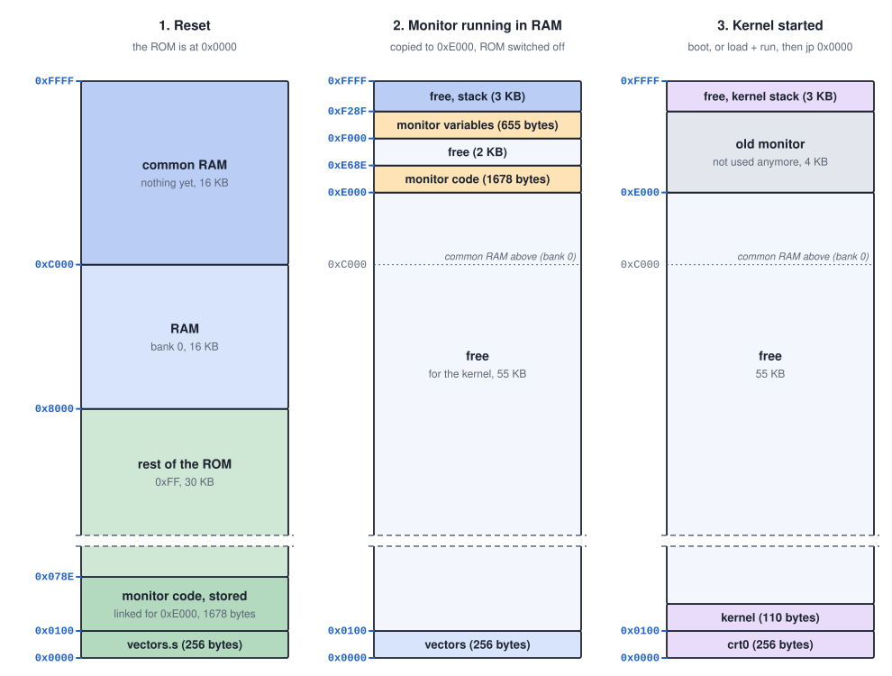

# Z80 kernel

A small Unix-like kernel in C (SDCC) for my Z80 board (rev B), plus the monitor that lives in the
ROM (`mon/`, in assembly). On reset the monitor copies itself to high RAM, then you can load a
kernel at 0x0000 from the CF card (`boot`) or over serial (`load` then `run`).

## Building and running

```bash
make                  # build/kernel.bin and build/kernel.ihx
make send-kernel      # send the kernel to the monitor and start it, then serial console
make monitor          # mon/build/monitor.rom
make flash-monitor    # write the ROM with the TL866 (minipro)
make send-monitor     # run a new monitor from RAM, to test it without flashing
make serial           # just the serial console (Ctrl-] to quit)
make fmt              # format the asm sources (fmt-check to only check)
make hooks            # run fmt-check before each commit (once per clone)
```

The serial port is shared by the NAS on `tower:7023` (ser2net, over Tailscale). If the board is
plugged into the Mac instead, set `Z80_PORT=/dev/cu.usbserial-XXXX`.

## Monitor commands

```
help    list the commands
list    files at the root of the CF card (Fuzix file system)
load    receive an Intel HEX file and write it to RAM
run     jump to 0x0000 (a ret comes back to the prompt)
boot    load kernel.bin from the CF card at 0x0000 and jump to it
```

## Memory map

512 KB of RAM in 8 banks of 64 KB. 0x0000-0xBFFF shows the bank selected in the latch (port 0x38,
bits 1-3), and 0xC000-0xFFFF is always bank 0. When ROM_DIS (bit 0 of the latch) is 0, the first
32 KB of the ROM hide the RAM at 0x0000-0x7FFF. Everything below happens in bank 0.



**1. Reset.** The latch is cleared, so the ROM is at 0x0000 and the Z80 starts there. `vectors.s`
copies `l__CODE` bytes from 0x0100 to `s__CODE` (0xE000) and jumps to `init`.

**2. Monitor running in RAM.** `init` runs from 0xE000. It sets the stack at the top of RAM,
disables the ROM (RAM at 0x0000 from now on), writes the two vectors again in RAM, and sets up the
CTC, the SIO and the CF card. `CODE_ADDR` and `DATA_ADDR` are set in `mon/Makefile`.

**3. Kernel started.** `boot` reads `kernel.bin` block by block from 0x0000 and gives up if it
would go past 0xDFFF. `load` just writes wherever the HEX file says, it doesn't check anything. Both
end with `jp 0x0000`, with interrupts off, bank 0, the SIO at 115200 8N1 and the CF card in 8-bit
mode. There's no way back to the monitor except a reset.

The figure is drawn by `tools/memmap.py` with the SVG kit of the book (`docs/explications/fig.py` in
z80-motherboard). It reads the sizes from `mon/build/monitor.map` and `build/kernel.bin`, so run it
again after `make` and `make monitor` when they change.

## Files

The kernel is split in three layers, as in Fuzix:

- `core/`: the kernel itself, which touches no port (`main.c`)
- `dev/`: the drivers (`sio.c`: SIO channel A, polled)
- `platform/`: what is specific to this board: `crt0.s` (entry point at 0x0000: vectors, stack,
  globals, then `main()`), `ports.h` (I/O ports for the C side, same as `mon/hw.inc`) and
  `sio_clock.c` (the CTC channel that clocks SIO channel A, for each speed)

Other files:

- `mon/`: the monitor, its Makefile, and `hw.inc` with the board's ports and registers
- `tools/monitor-send.py`: serial console and HEX upload
- `tools/asmfmt/`: formatter for the asm sources
- `tools/diag.awk`: adds columns to assembler errors so VS Code can underline them
- `tools/git-hooks/`: the pre-commit hook
- `tools/memmap.py`: draws `docs/memmap.svg`

Any `.c` file in `core/`, `dev/` or `platform/` gets compiled and linked. Headers are included from
the kernel root (`#include "dev/sio.h"`). There's no C library (`--nostdlib`). The
kernel has to fit in 0x0000-0xDFFF, and `make send-kernel` refuses anything bigger.
